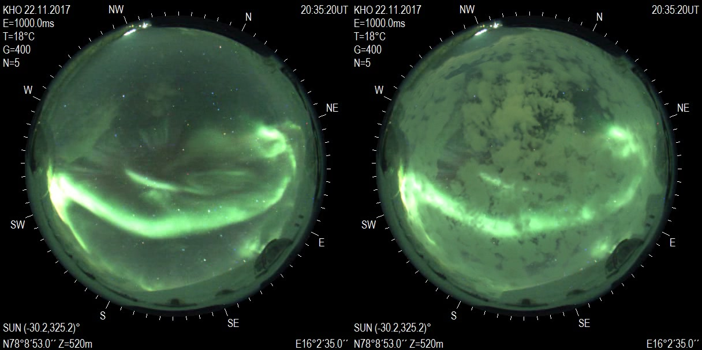
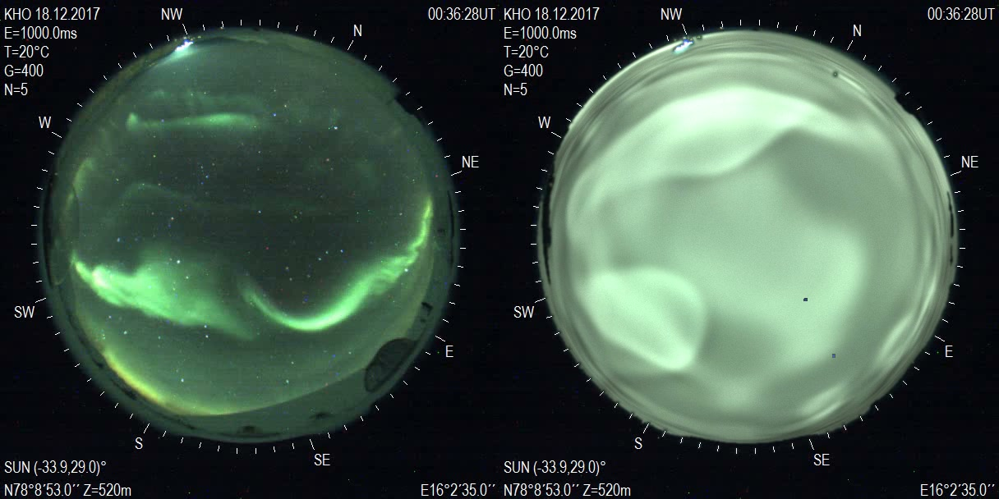
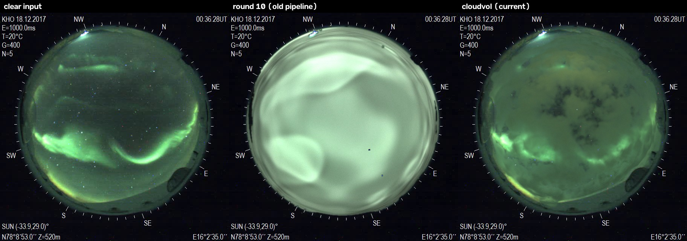
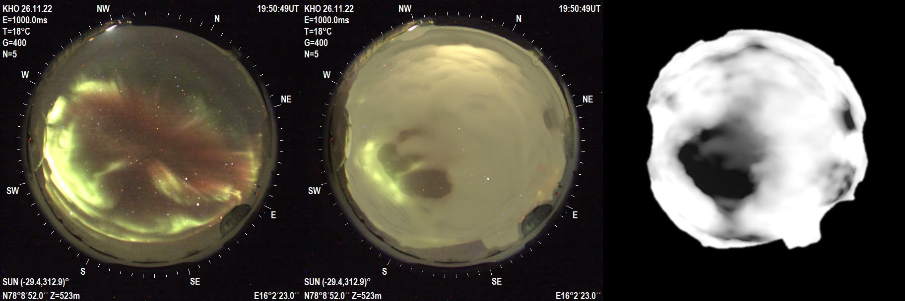
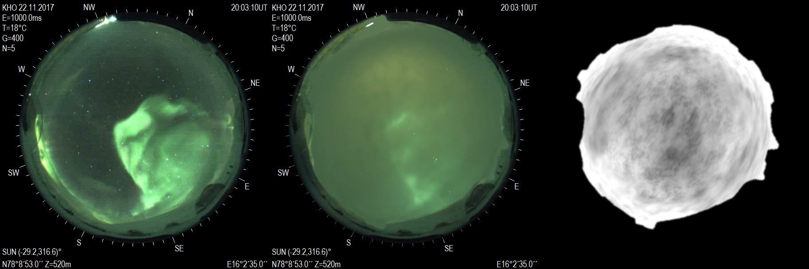
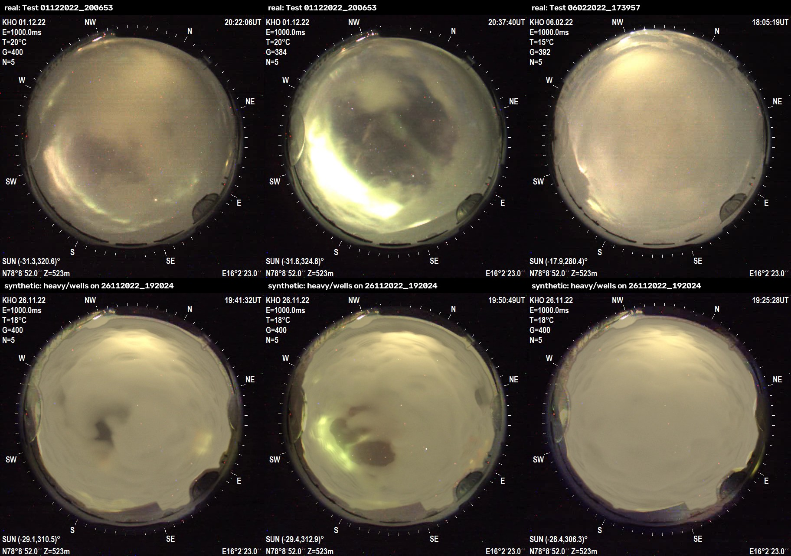

# Synthetic clouds for all-sky aurora footage

Adds realistic, temporally consistent, physically lit clouds to clear all-sky
aurora clips (KHO Svalbard, 608x608 fisheye, about 1 real second per frame,
played at 25 fps). Each run produces a (clear, cloudy, cloud-opacity mask)
triplet for training cloud-removal models.

The current pipeline is `cloudvol/`: a volumetric cloud renderer whose
parameters are measured from the 87 real cloudy clips in `Cloud_footage/`. It
has two scenario families: lighter skies where cloud and clear sky alternate,
and [heavy clouds](#heavy-clouds) that fill the whole sky like fog.

## Current result

Frame 2500 of `outputs_cloudvol/22112017_195302_s1_demo.mp4` — clear input on
the left, clouded output on the right:



For reference, frame 700 of the previous pipeline's last demo,
`outputs_v1_old/demo_progress_round10.mp4` (a different clear clip,
`18122017_000058`):



And the same clear frame through both, so the difference is like for like
(`18122017_000058`, source frame 2100; cloudvol with its `overcast` regime,
seed 3):



Round 10 reads as a milky filter over the lens: one smooth sheet, one tint,
terrain and instrument dome painted over. The current output has cloud bodies
with gaps and stars between them, aurora diffusing through thinner parts,
colour that changes with what is lighting the cloud, and an untouched
foreground.

## How the current pipeline works

The earlier pipeline drew a 2-D opacity map and blended the frame toward a
glow colour, so opacity and colour were the same quantity and "more cloud"
could only mean "more of the same tint". Real clouds in the reference clips do
not behave that way: thin cloud is often *brighter* than the clear sky beside
it while stars still show; thick cloud hides the aurora but glows in the colour
of the whole sky; the same cloud is yellow-green over the ground lights and
green under the aurora; gaps close toward the horizon.

`cloudvol` therefore models the cloud as a 3-D volume and computes light
transport through it.

1. **Scene statics** (`scene.py`). The sky mask comes from temporally
   persistent edges pooled over same-camera clips, so terrain, the instrument
   dome and the lens rim are excluded and clouds never paint over the
   foreground. Sensor hot pixels and the grain level are also measured.
2. **Cloud volume** (`render.py::density`, `textures.py`). Each layer is a
   thresholded 3-D Perlin-Worley-style field gated by an evolving coverage map
   and a height profile, with detail noise eroding the edges — the density
   modelling scheme of real-time volumetric cloudscapes [3][4], built on
   cellular noise [5] — defined in world kilometres and advected by wind. Every
   camera ray samples it on a stack of altitude planes through the measured
   fisheye geometry (curved Earth), with distance-based detail fading so the
   horizon does not shimmer.
3. **Light propagation** (`render.py::transport`). Optical depth is accumulated
   through the volume along three families of paths — down from the sky, up
   from the snow, and slanted from each ground light — each as a chain of
   image warps between neighbouring planes. Every sample gets its own
   illumination and shadowing.
4. **The clear frame is the light source** (`render.py::sky_light`). What a
   cloud scatters toward the camera is the clear frame itself, blurred more
   widely the deeper the light travelled through cloud (forward-scattering halo
   at first, isotropic glow when thick). Clipped aurora highlights get their
   hue restored first. Cloud colour therefore follows the aurora frame by
   frame.
5. **Compositing.** `out = clear x direct transmittance + in-scattered light`,
   in linear light, inside the sky mask only. Lost sensor grain is re-added and
   hot pixels are kept.

Temporal consistency is structural: frames are samples of one continuous 4-D
field (wind advection, two coverage fields drifting through each other, and
vertical "boiling" of the shape noise), not per-frame draws.

Brightness is not monotonic in thickness, by construction. Thin cloud adds
forward-scattered aurora light on top of an almost untouched background; thick
cloud removes the background and returns only what diffuses through, plus
whatever the ground lights put on its base.

### What is learned from the cloudy clips

The 87 reference clips are measured, not copied, and no neural model is
trained (`fit_refs.py`, `fit_motion.py`, `fit_prior.py` -> `cloudvol/data/prior.json`):

| quantity | measured value | used for |
|---|---|---|
| zenith drift, px/frame (p10 / p50 / p90) | 0.21 / 0.52 / 0.97 | winds are sampled from the empirical list |
| cloud pattern surviving 60 s (p10 / p50 / p90) | 0.61 / 0.76 / 0.88 | evolution rate |
| cloud pattern surviving 300 s | 0.43 / 0.56 / 0.70 | evolution rate |
| cloudy-sky colour, 2015-18 camera (zenith / mid / NW rim) | (66,86,72) / (75,96,79) / (91,113,89) | ground-light colour and direction |
| cloudy-sky colour, 2019+ camera (zenith / mid / NW rim) | (100,92,74) / (118,105,82) / (147,140,107) | ground-light colour and direction |
| dome luminance, structure contrast, star visibility | envelopes per camera era | `validate.py` scores synthetic clips with the same analysers |

Cloud shapes are procedural and were tuned by eye against the references.

### Variety

`weather.py::sample_scenario(seed, era)` draws a regime — broken deck, overcast
with holes, thin high veil, scattered fragments, cloud streets, two layers with
different winds, or a passing front — then its geometry, optical thickness,
texture scales, wind, evolution rates, a cover timeline (steady, trending or
pulsing) and ground-light strengths. The scenario is saved next to every output
and reproduces the render exactly. `outputs_cloudvol/variety_*.jpg` show all
seven regimes on two clips.

### How the demo scores against the references

| measure | demo (seed 1, `broken`) | reference clips |
|---|---|---|
| drift at zenith, px/frame | 0.27 | 0.21-0.97, median 0.52 |
| pattern kept after 1 min | 0.79 | median 0.76 |
| pattern kept after 5 min | 0.50 | median 0.56 |
| dome luminance | 94 | median 91 |
| mid-scale structure contrast | 0.121 | 95th percentile 0.114 |

Contrast is slightly above the reference range; the clear clip itself measures
0.15, so much of that is its own bright aurora showing through.
Frame-to-frame change under thick cloud is lower than in the clear input, so no
flicker is added.

## Heavy clouds

`python -m cloudvol.run <clip> --seed N --heavy` samples from a second family
(`cloudvol/heavy.py`) for decks that cover the whole sky, as in
`Test 01122022_200653` and `Test 12122022_145216`. Frame 1800 of
`outputs_cloudvol/26112022_192024_s1_heavy_demo.mp4` — clear input, clouded
output, and the thickness mask:



The same family on the older camera, frame 600 of
`outputs_cloudvol/22112017_195302_s2_heavy_demo.mp4` (two stacked decks): the
deck takes that camera's green-olive cast, and the aurora survives only as a
broad glow.



Real heavy cloud (top) beside synthetic (bottom), same camera:



### What the heavy references show

Eleven of the 87 reference clips keep their stars extinguished for the whole
hour. Measured on those (`cloudvol/data/prior.json` -> `heavy`):

| quantity (p10 / p50 / p90) | 2015-18 camera (3 clips) | 2019+ camera (8 clips) |
|---|---|---|
| dome luminance, 0-255 | 65 / 84 / 97 | 119 / 139 / 143 |
| mid-scale structure contrast | 0.016 / 0.033 / 0.054 | 0.012 / 0.030 / 0.058 |
| zenith colour (median) | (71, 108, 59) | (132, 125, 104) |
| zenith drift, px/frame (all 11) | 0.40 / 0.53 / 1.50 | |
| pattern kept after 60 s / 300 s (all 11) | 0.83 / 0.62 (median) | |

Three things follow. Heavy cloud is **bright**, not dark: on the newer camera
it is brighter than broken cloud (139 against 106), because light is trapped
between the snow and the closed cloud base. Its texture is **faint but never
absent**: slow swells of thickness and darker thin "wells" that open and
close. And it **keeps moving** at about the same angular speed as lighter
cloud, while holding its large-scale pattern slightly longer.

### How heaviness is produced

Not by colour, and not by coverage (the opacity mask is white almost
everywhere). A heavy deck is the same kind of object as every other cloud
here — a 3-D density field sampled along each camera ray — with these
differences:

* **Deep and moderately dense.** The slab is 0.7-1.5 km deep and filled at
  40-90% of its peak density almost everywhere; overhead optical depth is
  typically 10-60. Extinction is capped at 70 per km: a deck built from thin,
  very dense sheets cannot be sampled smoothly and shows every sampling plane
  as a contour line (it did, before this was fixed).
* **No thresholds, so no edges.** Thickness follows a smooth (sigmoid) ramp of
  the coverage field; the cloud base is diffuse, building up over a third of
  the slab; a residual haze fills the whole slab, so the thinnest spots dim
  the stars instead of baring them and gaps close smoothly toward the horizon.
* **Swells lag the wind.** The thickness pattern travels at 25-60% of the wind
  while finer texture streams through it, which is what gives slow-changing
  large structure with visible drift.
* **A second layer for parallax** in two of the four regimes: another deck
  above with its own wind, or a thin mist layer sliding underneath.

Three lighting extensions are switched on for this family (and are off by
default, so the lighter regimes render exactly as before):

* **Snow-cloud bounce.** Upwelling light is multiplied by
  `1 / (1 - bounce x deck reflectance)`: each round trip between snow and
  cloud base returns part of it. This is what makes a closed deck bright.
* **Three-level glow.** Light that has lost its direction still arrives from a
  patch of sky tens of degrees wide; only after ~20 optical depths does it
  come from the whole sky. Aurora above a heavy deck therefore survives as a
  broad soft glow rather than vanishing into a uniform tint.
* **Foreground relighting.** Terrain, instruments and the lens rim are lit by
  the sky. Under a tan overcast they would otherwise stay aurora-green from
  the clear frame, so they are rescaled by the ratio of clouded to clear sky
  radiance nearby (fixed lamps excluded).

Regimes (`heavy.HEAVY_REGIMES`): `fog` (one deep soft deck), `wells` (thins
into soft dark wells, then closes), `stacked` (two decks, different heights
and winds), `scud` (deck with a thin mist layer underneath).
`outputs_cloudvol/variety_heavy_*.jpg` show all four on two clips, each with
its thickness map.

### Masks

Every run now writes two lossless 8-bit mask videos, zero outside the sky mask:

* `_mask.mp4` — **opacity**, `255 x (1 - T)`, where `T` is the direct
  transmittance of the clear frame along the line of sight: how much of the
  clear sky is hidden.
* `_thickness.mp4` — **optical thickness**, `255 x log1p(tau) / log1p(80)`,
  where `tau` is the optical depth along the line of sight. Invert with
  `tau = expm1(v / 255 x log1p(80))`.

Under heavy cloud the opacity mask saturates to white and carries almost no
information; the thickness map keeps resolving the deck's structure (third
panel above). Both are stored with full-range lossless H.264, verified to read
back exactly with both ffmpeg and OpenCV. The formulas are repeated in each
run's `.json`.

### How the heavy demos score

Scored with the same analysers, against the heavy references of the matching
camera (`python -m cloudvol.validate <clip> --era B --heavy`):

| measure | `26112022_192024`, seed 1, `wells` | 2019+ heavy references (p10 / p50 / p90) |
|---|---|---|
| dome luminance | 145 | 119 / 139 / 143 |
| mid-scale structure contrast | 0.011 | 0.012 / 0.030 / 0.058 |
| star count | 2 | 0 / 1 / 3.9 |
| pattern kept after 60 s | 0.80 | 0.69 / 0.83 / 0.90 |
| pattern kept after 300 s | 0.53 | 0.47 / 0.62 / 0.70 |
| drift at zenith, px/frame | 0.17 | 0.40 / 0.53 / 1.50 |

| measure | `22112017_195302`, seed 2, `stacked` | 2015-18 heavy references (p10 / p50 / p90) |
|---|---|---|
| dome luminance | 95 | 65 / 84 / 97 |
| mid-scale structure contrast | 0.011 | 0.016 / 0.033 / 0.054 |
| star count | 2 | 1 / 1 / 1.8 |
| pattern kept after 60 s | 0.83 | 0.69 / 0.83 / 0.90 |
| pattern kept after 300 s | 0.64 | 0.47 / 0.62 / 0.70 |
| drift at zenith, px/frame | 0.40 | 0.40 / 0.53 / 1.50 |

Brightness, star suppression and persistence land inside the reference
ranges on both cameras. Two measures do not. Texture contrast is at or just
below the faint end of the range on both clips: these decks are smoother than
the typical real one. And on the first clip measured drift is low: the block
matcher locks onto the slow thickness swells, which were deliberately made to
lag the wind to get the five-minute persistence right, while the finer texture
moves at the sampled wind speed.

In frame 1800 the opacity mask is exactly 255 on 78% of sky pixels, while the
thickness map takes 141 distinct values over those same pixels; where opacity
is partial the two agree (`exp(-tau)` against `T`, median difference 0.005).

## Usage

```
python -m cloudvol.fit_refs   Cloud_footage cloudvol/data/ref_stats.json    # once
python -m cloudvol.fit_motion Cloud_footage cloudvol/data/ref_motion.json   # once
python -m cloudvol.fit_prior                                                # once
python -m cloudvol.run Clear_sky_footage/22112017_195302.avi --seed 7 --demo
python -m cloudvol.run Clear_sky_footage/22112017_195302.avi --seed 7 --heavy --demo-mask
python -m cloudvol.validate outputs_cloudvol/22112017_195302_s7_cloudy.mp4 --era A
python -m cloudvol.validate outputs_cloudvol/22112017_195302_s7_heavy_cloudy.mp4 --era A --heavy
```

`run` writes `<stem>_cloudy.mp4`, `_mask.mp4` and `_thickness.mp4` (see
[Masks](#masks)), `_demo.mp4` (clear | cloudy with `--demo`; plus the thickness
map with `--demo-mask`) and `<stem>.json` (the scenario, mask formulas and
per-frame statistics), where `<stem>` is `<clip>_s<seed>` or
`<clip>_s<seed>_heavy`. `--regime` forces a regime; `--scenario` replays a
saved one. A full 3600-frame clip takes roughly 45 minutes on an M3 (MPS), a
little longer for the heavy family.

Requires python3 with torch, numpy, scipy and opencv, and ffmpeg on PATH.

## Repository layout

```
cloudvol/             current pipeline (see above); cloudvol/data/ holds the fitted reference measurements
outputs_cloudvol/     scenarios of the demos and the regime variety sheets
docs/images/          pictures used in this README
docs/RESEARCH_cloud_realism.md   literature notes written during the previous pipeline (round 7)
```

Kept locally and not part of this repository:

```
Clear_sky_footage/    clear clips to cloud (KHO all-sky camera footage)
Cloud_footage/        87 real cloudy reference clips ("Test *.avi", KHO all-sky camera footage)
outputs_cloudvol/*.mp4   demos, cloudy clips and mask videos
outputs_v1_old/       previous pipeline's demo videos
outputs/              previous pipeline's round-6 output video
```

The raw footage belongs to the observatory (see References) and is not
redistributed here; rendered videos are left out for size. Per-clip sky-mask
caches are rebuilt automatically on first run.

## Known limits (initial version)

* Moonlit and twilight skies are not modelled: adding a moon would change the
  clear sky itself, not only the clouds. Some reference clips are of that kind
  and are not represented.
* Heavy family: only deep-night lighting is modelled. `Test 12122022_145216`
  is a twilight clip (sun 17-19 degrees below the horizon) whose cream and
  blue palette is not reproduced on deep-night clear clips; its structure - a
  sky-filling deck with a darker core that later breaks up - is. The heavy
  decks are somewhat smoother than typical real ones, and their measured drift
  is below the reference range (see the heavy results). The `scud` regime's
  mist layer can pick up a hard-edged bright patch over the nearby ground
  light on the 2015-18 camera.
* Regimes are not equally convincing. Broken decks, scattered fragments,
  two-layer skies and passing fronts look best; the overcast regime can still
  show an over-smooth deck edge, and cloud streets ("rolls") can look streaky.
* Ground-light positions and colours are set per camera era from zone colour
  statistics and a handful of inspected frames; the 2019+ era has been checked
  less than the 2015-18 era.
* Morphology is procedural, not learned. A learned texture prior for the
  density field is the natural next step if the procedural look proves limiting
  downstream.
* The sky mask stops at the first static outline, which also excludes a thin
  crescent of real sky behind lens-rim reflections.
* Frame time is assumed to be 1 s per frame (true for these clips).

Two lessons about the noise are worth keeping. Any 2-D field that gates the
volume (the coverage map) is extruded vertically, so it must contain no
wavelength shorter than the layer thickness, or it renders as vertical curtains
— radial streaks in the fisheye. And 3-D noise must be isotropic in kilometres,
not in texels. Both produced comb-like artefacts before they were fixed.

## Previous pipeline (benchmark)

The old demo videos are kept locally; the code that made them has been
removed and is not part of this repository. This is how the videos were made.

**The method.** `aurora_cloudsim/` started from a vendored copy of
SatelliteCloudGenerator [2] (a daytime-satellite cloud synthesiser: a per-frame
2-D Perlin transparency mask blended toward white) and rebuilt it for night
all-sky video:

* a single cloud *plane* at 1-3 km seen through the fisheye; a seeded periodic
  3-D value-noise field over (time, y, x), advected by wind, gave one 2-D
  optical-depth map per frame;
* direct transmittance `exp(-tau * sec(zenith))`, a thickness-dependent blur
  of the background, and a scattered-light term built from a heavily blurred
  copy of the frame plus a ground-glow colour measured from the clip;
* from round 6, "two-path" transport in code-value space (downwelling light
  decaying with depth, upwelling light returned with a saturating response),
  and a learned appearance correction: a small U-Net over quarter-resolution
  physical fields adding a bounded, band-limited, gated residual, trained
  adversarially (two-scale PatchGAN plus feature matching) on crops extracted
  from the cloudy clips;
* round 7 was a literature review (`docs/RESEARCH_cloud_realism.md`) after the
  round-6 output failed visual review for fog-filter softness, GAN colour
  mottling and a uniform bright rim;
* round 8 added a Worley erosion chain for the opacity map, grid-searched
  against texture-band statistics, and fitted per-band temporal decorrelation
  on all 87 clips;
* round 9 added pooled deck-light calibration (thick-deck hue, and per-channel
  amplification of cloudy over clear sky of 2.21 / 1.67 / 2.03) and fitted the
  low-band gain of the learned correction — the fit selected 0, switching that
  band off;
* round 10 is the final state of that code. Its sources carry no round-10
  labels, so what changed after round 9 is not recorded here.

**The videos.**

| file | what it is |
|---|---|
| `outputs_v1_old/Third_attempt.mp4` | early full-length single-panel render (19 July, 3598 frames) |
| `outputs/improved_18122017_000058.mp4` | round-6 published output, seed 33, regime `haze_patches`, learned appearance on |
| `outputs_v1_old/demo_progress.mp4` | first of the three 24 July demos (unlabelled; by timestamp, presumably round 8) |
| `outputs_v1_old/demo_progress_round9.mp4` | round 9 |
| `outputs_v1_old/demo_progress_round10.mp4` | round 10 |

The three `demo_progress*` files are clear | cloudy side by side on
`18122017_000058`, using every third source frame (1198 frames).

**Why it was replaced.** It passed its own statistical checks, invariant tests
and audits while still looking like a haze filter. The cloud was a single 2-D
sheet whose opacity and brightness came from the same scalar, so it had no
depth, no gaps closing with perspective, and no way for thick and thin cloud to
be lit differently. Statistics alone did not catch that; looking at frames did.

## References and acknowledgements

This repository contains no code from other projects. It builds on the
following data and published work:

1. **Footage.** All clips are from the all-sky camera of the Kjell Henriksen
   Observatory (KHO), The University Centre in Svalbard (UNIS), Longyearbyen,
   Svalbard — <https://kho.unis.no>. The footage is not included here.
2. **SatelliteCloudGenerator.** Czerkawski, M., Atkinson, R., Michie, C. and
   Tachtatzis, C. (2023). "SatelliteCloudGenerator: Controllable Cloud and
   Shadow Synthesis for Multi-Spectral Optical Satellite Images." *Remote
   Sensing* 15(17), 4138. <https://doi.org/10.3390/rs15174138>. Code:
   <https://github.com/strath-ai/SatelliteCloudGenerator>. This was the
   starting point of the previous pipeline (see above); none of it is used by,
   or included with, the current one.
3. Schneider, A. and Vos, N. (2015). "The Real-time Volumetric Cloudscapes of
   Horizon: Zero Dawn." *Advances in Real-Time Rendering in Games*, SIGGRAPH
   2015. The coverage-gated, height-profiled, detail-eroded density model in
   `cloudvol/render.py` follows this scheme.
4. Schneider, A. (2017). "Nubis: Authoring Real-Time Volumetric Cloudscapes
   with the Decima Engine." *Advances in Real-Time Rendering in Games*,
   SIGGRAPH 2017.
5. Worley, S. (1996). "A Cellular Texture Basis Function." *Proceedings of
   SIGGRAPH '96*, 291-294. Cellular noise used in `cloudvol/textures.py`.

`docs/RESEARCH_cloud_realism.md` lists the wider literature consulted during
the previous pipeline, with links.

Software used: PyTorch, NumPy, SciPy, OpenCV and FFmpeg.
